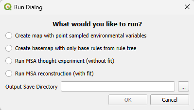
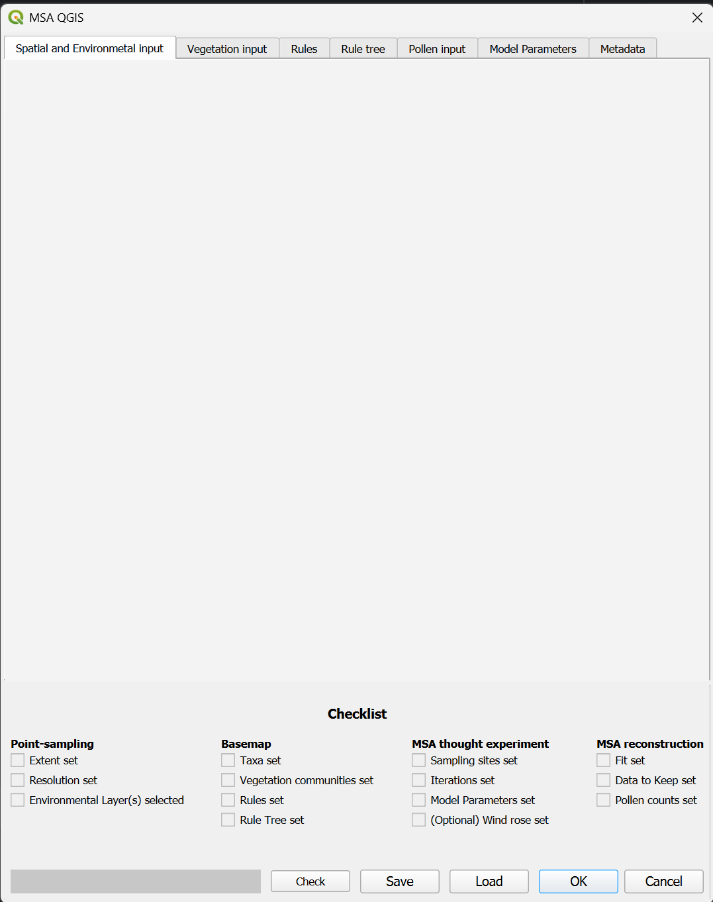

# Run types

MSA-Q has four run types: point-sampling, basemap, thought experiment and full reconstruction. Each next run type includes the other (for example, when running a "thought experiment", the programme also runs through the code for the point-sampled map and basemap), meaning they need increasing amounts of input. The first two, point-sampling and basemap, mainly exist to provide intermediate steps from which a thought experiment or full reconstruction run can be started, saving time for repeated runs. They can also provide a method for customization, if the modelling options in MSA-Q do not suffice. The "thought experiment" and full reconstruction are complete modelling runs.

Choosing the run type happens in the run dialogue, which pops up when "OK" is clicked in the main dialogue window.

Since the different run types require different amounts of input, the checklist is subdivided into the run types.

*the run dialog window*

*The main dialog window*

## Create map with point-sampled environmental variables

This option creates the grid of equally spaced, possibly nested, vector points as defined in the Spatial and Environmental input tab. The information from given (environmental) input maps is added to this grid of vector points in the form of columns. The only required information is:

* [Area of Interest](spatial_and_environmental_input.html#area-of-interest) is set
* [Resolution](spatial_and_environmental_input.html#resolution) is set
* At least one [environmental input map](spatial_and_environmental_input.html#available-fieldsbands) is given

The output is a [point-sampled map](output_files.html#pointsampled_mapsqlite-and-pointsampled_mapcsv), which is the "skeleton" map into which vegetation communitie can be placed. Both a .csv and .sqlite file version are created. These files can be used as input to skip (re-)creating a point-sampled map when continuing with one of the other run types, see [starting point](spatial_and_environmental_input.html#starting-point).

**This option should not take much more than an hour to run in most cases. Time increases mainly with area of interest size, resolution and slightly with number of included (environmental) input maps**

## Create basemap with only base rules from the rule tree
This option fills the previously created point-sampled map with the rules designated as belonging to the [base group](rule_tree_input_tab.html#designate-as-base-group) in the [rule tree](rule_tree_input_tab.html). The required input, in addition to the requirements of the point-sampled map, are:

* [Taxa](vegetation_input.html#taxa) needs to be set (at least those required for your base group rules)
* [Vegetation communities](vegetation_input.html#communities) needs to be set (at least those required for your base group rules)
* [Rules](rules_input_tab.html) need to have been made (at least the rules that are included in the base group rule blocks)
* [Rule tree](rule_tree_input_tab.html) needs to have been filled (at least with the base group rule blocks)

The output is a [basemap](output_files.html#output_basemapsqlite-and-basemapcsv). This is a vegetation map where only the rules from the basegroup have been implemented. Both a .csv and .sqlite version are created. These files can be used as input to skip creating the basemap when continuing with a thought experiment or full reconstruction, see [starting point](spatial_and_environmental_input.html#starting-point).

**This option should not take much more than an hour to run in most cases, and in small, simple cases can take only seconds or minutes. Time increases mainly with area of interest size, resolution and slightly with number of included (environmental) input maps**

## Run MSA thought experiment (without fit)
This option runs the MSA **without** calculating fit scores in comparison to given pollen counts. The main goal is provide a method for creating simplified, partially or fully simulated experiments that explore modelled behaviour. In addition to the input from the point-sampled map and basemap, the required inputs are:

* At least one [sampling site](pollen_input_tab.html) is set.
* [Number of interations](rule_tree_input_tab.html#number-of-iterations) is set to at least 1.
* The [model parameters](model_parameters_input_tab.html) are set. 
 
Optionally, a [wind rose](model_parameters_input_tab.html#windrose-weighting) can be set for the model, and a quick check for whether this has been done exists in the checklist.

The full set of [output files](output_files.html) is created, although the columns for fit score in [simulated_landscapes_and_likelihoods](output_files.html#simulated_likelihood_and_landscapecsv) are left empty.

**An MSAte can take significant amounts of time to run, depending on the complexity of the set-up. Some take only minutes, others can take hours. This mainly scales with area of interest size, resolution and number of iterations.**

## Run MSA reconstruction (with fit)
This option runs the full MSA, including calculation of fit scores in comparison to given pollen counts. The main goal of this run type is to make complete pollen-based vegetation cover reconstructions. In addition to the input from the other three run types, the required inputs are:

* [fit threshold](model_parameters_input_tab.html#desired-fit) has been set.
* [Which level of information to keep](model_parameters_input_tab.html#data-to-keep) has been determined
* [Pollen percentages](pollen_input_tab.html#pollen-percentage-file-paths) have been provided for all sampling sites.

The full set of [output files](output_files.html) is created.

**A full MSA reconstruction will take a significant amount of time: hours and possibly days. This mainly scales with area of interest size, resolution, number of iterations and number of sampling sites.**